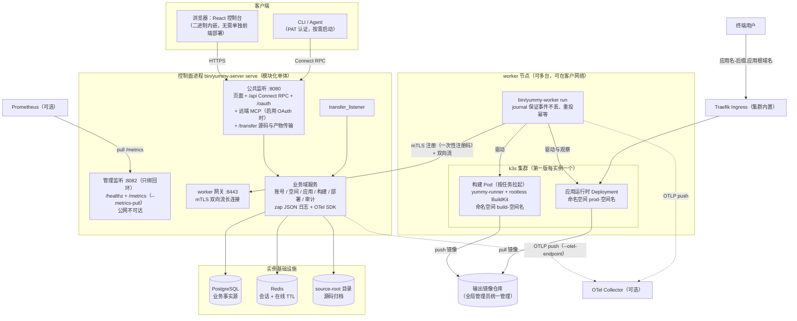
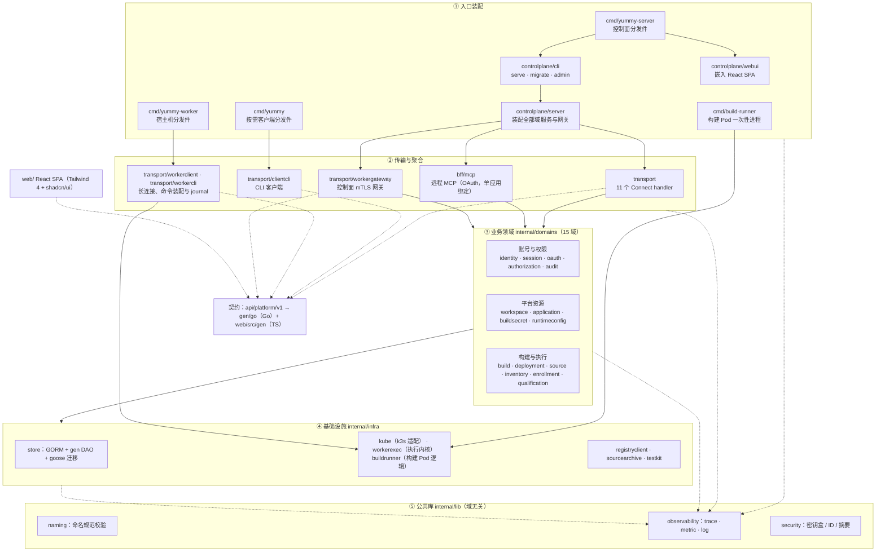

# 架构总览

两张图帮助快速建立全局认识：**部署架构**回答"进程跑在哪、怎么连"，**代码模块分层**回答"代码怎么归类、依赖朝哪流"。约定与细则见 [AGENTS.md](../AGENTS.md)，运维手册见 [operations.md](operations.md)。

## 一、部署架构

部署要点速查：

| 项 | 说明 |
|---|---|
| 常驻进程 | 控制面 ×1 + worker ×N；构建 Pod 按任务拉起、结束即退，不算常驻 |
| 按需客户端 | CLI（`yummy`）——不新增任何常驻服务 |
| 控制面监听 | :8080 页面/API/传输（传输自带 10 分钟截止，业务 30s 超时预算）、:8082 管理面 /healthz 与 /metrics 只绑回环、:8443 worker mTLS |
| 数据三件套 | PostgreSQL（事实源）+ source-root（归档）+ master-key，备份必须成套 |
| 命名约定 | 构建 `build-<空间名>`、运行 `prod-<空间名>`、Deployment `<应用名>-<部署名>`、地址 `<应用名>-<后缀>.<根域名>` |
| 网络边界 | worker 主动外连控制面，客户网络只需放行控制面 8443 入站；运行命名空间只放行同命名空间与 Traefik 入站 |
| 可观测性 | pull：serve `--metrics-pull` 暴露 `/metrics`；push：`--otel-endpoint`（或 `OTEL_EXPORTER_OTLP_ENDPOINT`）推 OTLP，三进程统一 |
| 一次性命令 | `migrate`（带锁迁移）、`admin init`（首位全局管理员）、`yummy-worker register`（一次性注册码登记） |

## 二、代码模块分层

分层规则（详见 [AGENTS.md 后端代码分层与模块化](../AGENTS.md#后端代码分层与模块化)）：

1. **依赖严格单向**：①→②→③→④；公共库⑤不依赖任何业务域，领域不 import 传输与装配细节。
2. **域内高内聚**：模型、数据访问、服务同域组织；域间只通过对方显式导出的接口依赖，禁止跨域直查对方数据表或引用内部 struct。
3. **数据访问收口**：常规 CRUD 走 GORM（gen DAO 按域渗透中），复杂 SQL（CTE、锁、RETURNING）集中在各域的数据访问文件；PG 特有能力一律带【数据库专有】注释并写明 MySQL 替代方案——业务代码不出现 SQL 字符串。
4. **可观测性统一**：三信号 SDK 初始化只在 `internal/lib/observability`；业务侧只取 logger（`LoggerFrom(ctx)` 注入 trace_id）与 meter。
5. **分发边界**：`yummy-server` 嵌入 Web 并提供网关服务端；`yummy-worker` 消费 proto 命令并依赖纯运行配置类型与校验。`make check-binary-deps` 检查三个入口各自的依赖。
