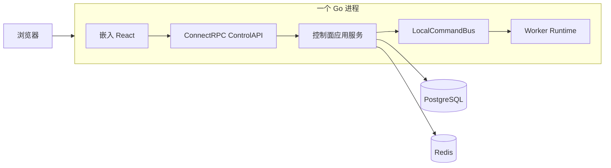
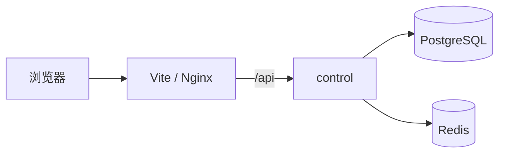
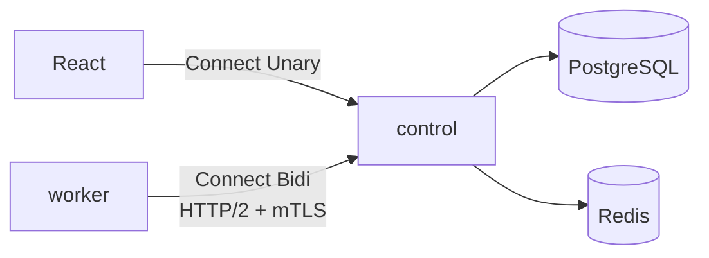
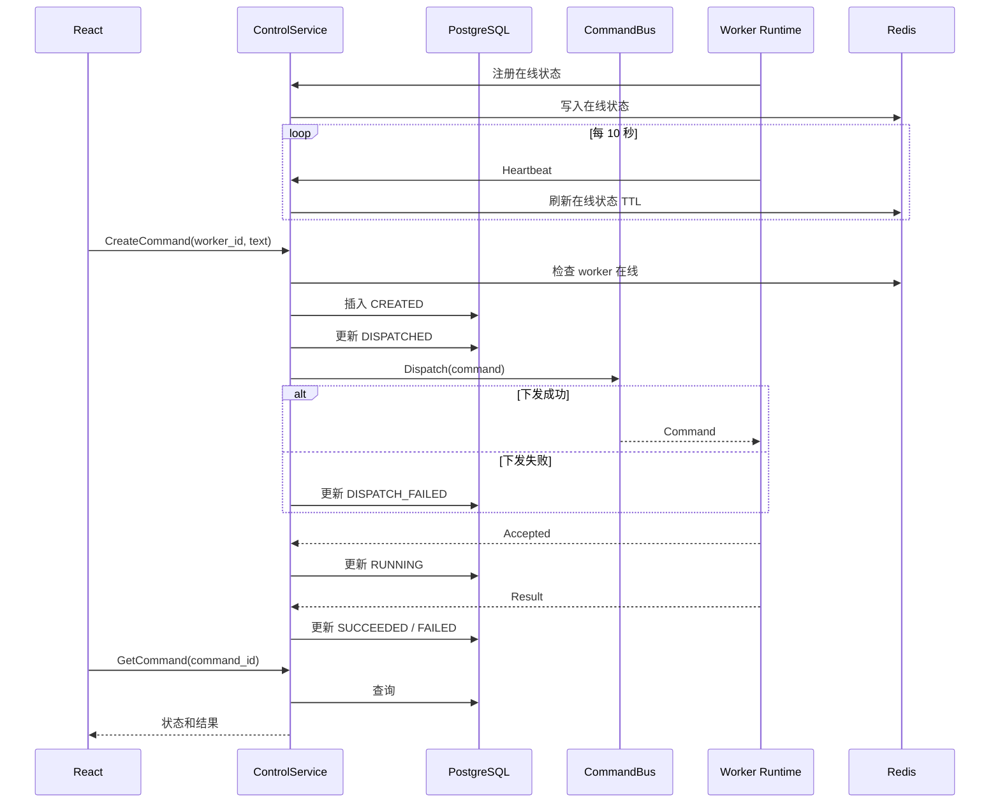

# React + Go 多拓扑部署 Demo 设计

## 1. 背景与目标

本 Demo 用一套 React 与 Go 代码验证三种部署拓扑：

1. 单二进制、单 Go 进程部署；
2. React 前端与 Go 后端分离部署；
3. 控制面与 worker 分离为多个 Go 进程部署。

三种拓扑必须复用同一套控制面业务、worker runtime、任务模型和持久化实现。部署形态只改变程序的装配入口和通信适配器，不复制业务逻辑。

应用以 PostgreSQL 作为持久数据的唯一事实来源，以 Redis 保存 worker 在线状态并为未来多控制面路由保留扩展位置。当前规模为几十个 worker，最多几百个；当前只实现单控制面实例。

“单二进制部署”仅指 React 静态资源、控制面和本地 worker 可以组合进一个可执行文件与一个 Go 进程，PostgreSQL 和 Redis 仍是外部基础设施。

## 2. Demo 范围

### 2.1 实现范围

- React 页面展示在线 worker。
- 用户选择 worker 并提交文本。
- 控制面创建 `uppercase` 指令。
- worker 将文本转换为大写并回传结果。
- 控制面把指令输入、状态、结果和错误保存到 PostgreSQL。
- worker 向控制面发送心跳，由控制面刷新 Redis 在线状态。
- 单进程模式通过进程内通信执行指令。
- 分布式模式通过 ConnectRPC 双向流和 mTLS 执行指令。
- 提供开发 CA、服务端证书和 worker 证书生成脚本。
- 提供 Docker Compose 启动 PostgreSQL 和 Redis。
- 提供三种部署方式的运行说明与自动化测试。

### 2.2 明确不实现

- 不执行任意 Shell 命令。
- 不实现断线期间的可靠投递、自动重投和消息队列。
- 不实现完整的一次性注册码、CSR 签发、证书吊销和轮换后台。
- 不实现多控制面实例、选主、跨实例指令路由和高可用。
- 不实现通用插件系统或动态任务类型。
- 不接入真实 AI 模型，仅为后续 PostgreSQL AI 数据能力保留空间。

## 3. 方案选择

采用“模块化单体 + 多个装配入口”。

仓库提供一个万能入口和两个精简入口：

- `platform`：支持 `all`、`control`、`worker` 三种子命令；未指定子命令时默认执行 `all`；
- `control`：只装配控制面；
- `worker`：只装配 worker。

所有入口调用 `internal/bootstrap` 中的同一组装配函数。`cmd` 目录只负责参数解析、配置加载、信号处理和调用装配函数，不包含业务逻辑。

与单万能二进制相比，该方案既保留最简单的交付方式，又能生成不携带无关控制面或前端资源的精简 worker。与完整微服务方案相比，它满足当前规模且不提前引入连接网关、消息队列和调度服务。

## 4. 总体架构

### 4.1 单进程拓扑

启动方式：

```bash
./platform all
```

`./platform` 与 `./platform all` 等价。

一个 Go 进程包含 React 静态资源、ControlAPI、控制面应用服务、本地 worker、worker runtime 和 `LocalCommandBus`。



本地 worker 不绕行本机 HTTP，也不进行 Protobuf 序列化。`LocalCommandBus` 必须产生与远程总线一致的接收确认、进度和结果事件。

### 4.2 前后端分离拓扑

启动方式：

```bash
./control
pnpm --dir web dev
```

生产环境可以由 Nginx 或 CDN 托管同一份 `web/dist`。前端固定使用相对路径 `/api`，开发时由 Vite 代理，生产时由 Nginx 反向代理。



### 4.3 控制面与 worker 分离拓扑

启动方式：

```bash
./control
./worker --id worker-1
```

也可以仅分发万能二进制：

```bash
./platform control
./platform worker --id worker-1
```



worker 主动连接控制面，因此客户侧不需要开放入站端口。

## 5. 目录结构

```text
.
├── api/
│   └── demo/v1/demo.proto
├── gen/
│   └── go/
├── cmd/
│   ├── platform/
│   ├── control/
│   └── worker/
├── internal/
│   ├── bootstrap/
│   ├── control/
│   ├── worker/
│   ├── commandbus/
│   │   ├── local.go
│   │   └── connect.go
│   ├── repository/postgres/
│   ├── presence/redis/
│   ├── transport/connectrpc/
│   └── webui/
├── web/
│   ├── src/
│   │   └── gen/
│   └── dist/
├── migrations/
├── deploy/
│   └── nginx.conf
├── scripts/
│   └── generate-dev-certs.sh
├── compose.yaml
├── Makefile
└── README.md
```

## 6. 组件边界

### 6.1 控制面应用服务

职责：

- 查询在线 worker；
- 校验创建指令的输入；
- 创建并持久化指令；
- 通过 `CommandBus` 下发指令；
- 消费 worker 事件并推进指令状态；
- 向 React 暴露查询与创建接口。

依赖：

- `CommandRepository`；
- `WorkerRepository`；
- `PresenceStore`；
- `CommandBus`。

控制面应用服务不得直接依赖 ConnectRPC 流或本地 channel。

### 6.2 Worker Runtime

职责：

- 接收统一的领域指令；
- 校验指令类型和参数；
- 调用 `uppercase` 执行器；
- 发布 `Accepted`、`Progress` 和 `Result` 事件；

worker runtime 不依赖 PostgreSQL、Redis 或 React。

远程模式的心跳、双向流和断线重连由 Connect worker client 负责，不属于
worker runtime。

### 6.3 CommandBus

控制面依赖以下语义，不依赖具体传输：

```go
type CommandBus interface {
    Dispatch(ctx context.Context, command Command) error
}
```

worker 事件通过独立的事件接收接口回到控制面。具体 Go 签名可以在实施计划中根据并发模型细化，但本地和远程实现必须通过相同契约测试。

- `LocalCommandBus`：使用进程内 channel 调用同进程 worker runtime；
- `ConnectCommandBus`：将指令写入目标 worker 的 ConnectRPC 双向流。

### 6.4 PostgreSQL Repository

PostgreSQL 保存：

- worker 基本信息；
- command ID、目标 worker、输入和创建时间；
- command 状态；
- 执行结果、错误和状态更新时间。

状态机为：

```text
CREATED
  ├── DISPATCH_FAILED
  └── DISPATCHED
        ├── DISPATCH_FAILED
        └── RUNNING
              ├── SUCCEEDED
              └── FAILED
```

状态更新必须带当前状态条件，避免并发事件让状态倒退。

### 6.5 Redis Presence Store

Redis 使用带 TTL 的 key 保存 worker 在线状态。worker 每 10 秒发送一次心跳，在线 key 的 TTL 为 30 秒。

在线记录包含：

- worker ID；
- 当前 control instance ID；
- 最近心跳时间；
- worker 版本。

当前单控制面阶段，进程内连接表是实际发送指令的位置，Redis 用于在线查询和未来路由扩展。任务结果不得只保存在 Redis。

## 7. ConnectRPC 接口

```protobuf
service ControlService {
  rpc ListWorkers(ListWorkersRequest) returns (ListWorkersResponse);
  rpc CreateCommand(CreateCommandRequest) returns (CreateCommandResponse);
  rpc GetCommand(GetCommandRequest) returns (GetCommandResponse);
}

service AgentService {
  rpc Connect(stream AgentMessage) returns (stream ControlMessage);
}
```

`AgentMessage` 使用 `oneof` 承载：

- `Hello`；
- `Heartbeat`；
- `CommandAccepted`；
- `CommandProgress`；
- `CommandResult`。

`ControlMessage` 使用 `oneof` 承载：

- `Welcome`；
- `Command`。

React 仅使用 Unary RPC，并通过短轮询读取任务状态。Demo 不使用浏览器双向流，也不引入 Connect Query。

Go worker 使用 ConnectRPC 双向流。Connect handler 保持对 Connect、gRPC 和 gRPC-Web 协议的兼容，但 Demo 的 Go worker 默认使用 Connect 协议。

Connect worker client 负责建立双向流、发送 `Hello` 与心跳、串行发送
worker 事件，以及在连接断开后执行指数退避重连。worker runtime 只处理
领域指令并产生领域事件。

## 8. 网络与证书

控制面启动两个监听器：

- 公共监听器：默认 `:8080`，提供 ControlService 和健康检查；当装配入口注入前端资源时，同时提供 React 静态资源；
- agent 监听器：默认 `:8443`，启用 TLS、HTTP/2 和强制客户端证书校验，仅挂载 AgentService。

开发证书脚本生成：

- 开发 CA；
- 包含 `localhost` 和 `127.0.0.1` SAN 的服务端证书；
- 身份为 `worker-1` 的客户端证书。

证书和私钥生成到被 `.gitignore` 排除的目录，不提交私钥。Demo 可以从客户端证书读取 worker 身份，并校验其与 `Hello.worker_id` 一致。

生产设计仍采用“一次性注册码换取证书”，但注册和签发流程不属于本 Demo。

## 9. 前端构建与嵌入

React 使用 TypeScript 和 Vite。

构建顺序：

1. 从 `.proto` 生成 `gen/go` 下的 Go 代码与 `web/src/gen` 下的 TypeScript 代码；
2. 构建 React，产出 `web/dist`；
3. 将同一份 `web/dist` 放入 `internal/webui` 可嵌入路径；
4. 构建 `platform`。

`platform` 通过 `go:embed` 提供静态资源。`control` 精简入口不导入嵌入资源包，因此前后端分离时不会携带 React 静态资源。

React 的 Connect transport 使用相对地址 `/api`。控制面把 Connect handler 挂载在 `/api` 前缀下。

## 10. 数据流



本地与远程模式只替换图中的 `CommandBus`，其他组件不变。

## 11. 失败处理

- PostgreSQL 或 Redis 在启动阶段不可达：启动失败并输出明确错误。
- worker 离线：创建指令后下发失败，状态更新为 `DISPATCH_FAILED`。
- worker 在规定时间内未确认：状态更新为 `DISPATCH_FAILED`，不自动重投。
- worker 执行器返回错误：状态更新为 `FAILED` 并保存错误文本。
- 双向流断开：连接表立即移除连接；worker 指数退避重连；Redis 在线 key 由 TTL 失效。
- 控制面与 worker 身份不匹配：拒绝双向流并返回未认证错误。
- 进程退出：停止接收新请求，取消后台循环，等待有限时间后关闭 HTTP 服务、数据库连接和 Redis 客户端。

ConnectRPC 双向流只是通信通道，不提供消息持久化、ACK 重投和断线补发语义。

控制面必须在调用 `CommandBus.Dispatch` 前把状态从 `CREATED` 更新为
`DISPATCHED`；如果下发失败，再从 `DISPATCHED` 更新为
`DISPATCH_FAILED`。这样可以避免单进程模式中 worker 立即返回
`Accepted`，而持久化状态仍停留在 `CREATED` 的竞态。

## 12. 未来多控制面演进

当前不实现多控制面，但保留以下边界：

- PostgreSQL 是共享持久状态；
- Redis 在线记录包含 control instance ID；
- `CommandBus` 隔离指令路由；
- 定时任务与调度逻辑不写入 HTTP handler；
- agent 连接不被伪装成可跨进程共享对象。

未来增加多控制面时，可以在 `CommandBus` 后加入基于 Redis 或消息系统的跨实例路由，并为需要单实例执行的后台任务增加 leader election。该演进不得改变控制面业务服务或 worker runtime 的公开接口。

## 13. 测试策略

### 13.1 单元测试

- `uppercase` 执行器输入输出；
- 指令状态机合法与非法转换；
- 控制面下发失败时的状态；
- worker 身份校验；
- 配置解析。

### 13.2 契约测试

对 `LocalCommandBus` 和 `ConnectCommandBus` 运行同一组场景：

- 指令被接收；
- 产生运行中事件；
- 成功返回大写结果；
- 执行错误被传回；
- 连接不可用时返回明确错误。

### 13.3 集成测试

- PostgreSQL migration 和 repository；
- Redis TTL 与心跳刷新；
- 带开发证书的 ConnectRPC mTLS 连接；
- 公共监听器不能访问 AgentService；
- agent 监听器拒绝无客户端证书的请求。

### 13.4 三拓扑冒烟测试

- `platform all` 完成一次任务；
- 独立 React 调用 `control` 完成 API 请求；
- 独立 `worker` 通过 mTLS 完成一次任务。

## 14. 验收标准

- `platform all` 能以一个应用进程完成页面下发和任务执行。
- React 独立运行时可以调用同一个 ControlService。
- 独立 worker 能通过真实 mTLS ConnectRPC 双向流接收任务并返回结果。
- `platform worker` 与精简 `worker` 行为一致。
- 三种模式共用同一控制面服务、worker runtime 和任务模型。
- PostgreSQL 可以查询到任务输入、状态、结果和错误。
- Redis 在线状态随心跳刷新，并在 worker 停止后自动过期。
- 本地总线和 ConnectRPC 总线通过相同契约测试。
- README 包含依赖启动、证书生成、构建和三种模式的完整命令。

## 15. 参考资料

- [ConnectRPC Go Streaming](https://connectrpc.com/docs/go/streaming/)
- [ConnectRPC gRPC Compatibility](https://connectrpc.com/docs/go/grpc-compatibility/)
- [ConnectRPC Deployment and h2c](https://connectrpc.com/docs/go/deployment/)
