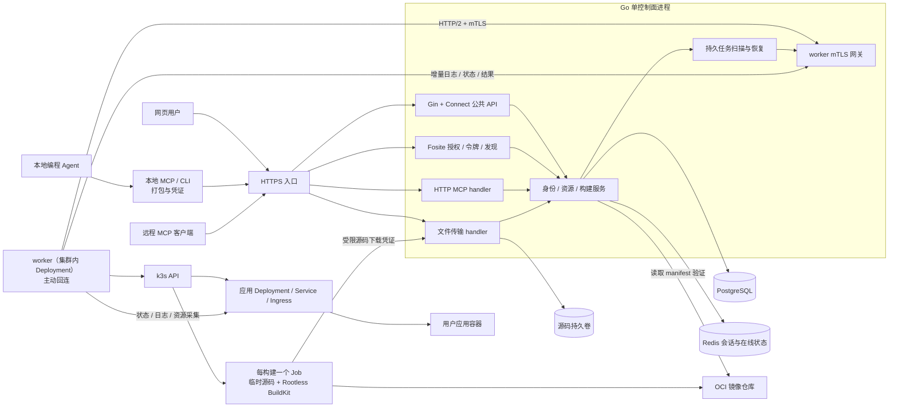
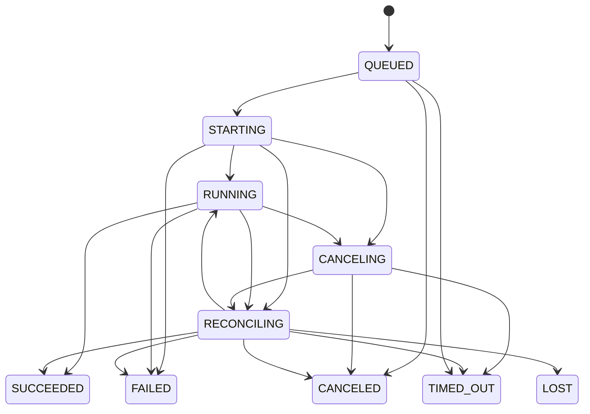

# Yummy 第一期技术方案：构建基础与 PaaS 运行集成

2026-10-24 交付模型修订：基础设施由实例管理员统一管理，工作空间不能自定义；以 [交付方式与实例边界](2026-10-24-delivery-model-and-instance-boundaries-design.md) 为准。

状态：待评审草案。初稿：2026-10-22；更新：2026-10-23（两层资源模型、管理入口及内嵌 OAuth）。配套：[产品方案](2026-10-22-agent-first-build-product-design.md)、[前端方案](2026-10-22-agent-first-build-frontend-design.md)。2026-10-24 的资源与字段边界以 [创建与配置边界复核](2026-10-24-application-configuration-boundaries-design.md) 为准。2026-10-26 修订集群/环境/部署、命名与最小 CLI，细则见 [命名、集群与最小 CLI](2026-10-26-naming-cluster-and-minimal-cli-design.md)。本次只进行设计与界面原型，不表示后端功能或集群环境已经验证。

本稿保留构建基础细节；首发运行、变量、域名、日志、监控和回滚的完整补充见 [首期运行方案](2026-10-23-paas-v1-runtime-design.md)，属于第一期范围而非后续选配。

## 1. 现有 demo 与复用边界

以当前 `main` 分支为起点。检查时 HEAD 为 `0c8a183`，工作区原先无修改。本次未为设计任务运行 Go/前端产品测试或修改远程服务器。

| 已验证的代码事实 | 复用方式 | 尚缺能力 |
|---|---|---|
| [bootstrap/control.go](../../../internal/bootstrap/control.go:20) 装配单控制面与远程连接表 | 保留业务与装配分层 | 身份、资源、构建应用服务和后台恢复循环 |
| [bootstrap/all.go](../../../internal/bootstrap/all.go:25) 组合本地 runtime | 保留单进程开发形态 | 本地调用同样需要业务授权；构建仍在隔离执行环境运行 |
| [agent_handler.go](../../../internal/transport/connectrpc/agent_handler.go:53) 校验证书身份、Hello 和事件来源 | 复用 mTLS 与主动回连 | 集群登记、证书生命周期和撤销检查 |
| [worker_client.go](../../../internal/transport/connectrpc/worker_client.go:80) 建立流并回传事件 | 保留传输适配器 | 当前接收循环同步执行任务，需拆出执行管理器以接收取消/恢复消息 |
| [control/service.go](../../../internal/control/service.go:130) 进度事件直接返回 | 保留事件推进的业务边界 | 构建日志与阶段必须持久化，不能复用当前忽略进度的实现 |
| [commands.go](../../../internal/repository/postgres/commands.go:69) 按预期状态更新 | 延续条件更新语义 | 构建、执行记录、事件幂等和恢复状态 |
| [bootstrap/http.go](../../../internal/bootstrap/http.go:18) 公共 API 无身份中间件，普通 HTTP 服务超时 30 秒 | 接入 Gin 和统一身份上下文，保留 Connect handler | 独立文件传输超时配置，避免上传被 30 秒截断 |
| [README](../../../README.md:9) 仅支持 uppercase，PostgreSQL 持久化、Redis 在线状态 | 保留存储职责划分 | 不能把现有在线表和流视为可靠任务队列 |

当前 Go worker 显式使用 `connect.WithGRPC()`，即通过 ConnectRPC 生成的服务使用 gRPC/HTTP2；扩展时以实现和契约测试为准，不依赖旧设计文档中关于默认协议的描述。

## 2. 技术选型

优先使用用户熟悉的组件和成熟库。业务流程、资源归属及状态机由项目实现；HTTP、ORM、会话、授权计算、配置、日志、构建与 Kubernetes 操作复用现成组件。

| 层次 | 推荐 | 理由与边界 |
|---|---|---|
| Go 运行时 | 沿用 `go.mod` 与工具链约束 | 不为设计任务升级版本 |
| HTTP 与中间件 | Gin | 用于公共入口、会话、上传和下载；通过 `http.Handler` 适配挂载 Connect，业务不重复建设 REST 与 RPC 两套实现 |
| 业务协议 | Protobuf + ConnectRPC | 沿用生成的 Go/TS 客户端、错误码与 worker 双向流 |
| 数据访问 | GORM + GORM Gen + PostgreSQL | 新模块使用类型化 DAO；允许少量明确的事务/锁 SQL；逐步替换 demo 的直接 pgx repository，过渡期共用数据库且每个事务只有一个事务管理者 |
| 迁移 | Goose，版本化 SQL | 表、索引和初始策略可审查；生产禁用 GORM AutoMigrate |
| 配置与 CLI | Viper + Cobra | 类型化配置、环境变量与命令行；Viper 仅在装配层读取，不在业务内使用全局实例 |
| 日志 | Zap + gin-contrib/zap | 统一 JSON 与字段；demo 的 slog 通过适配或逐步替换进入同一日志出口 |
| 浏览器会话 | gin-contrib/sessions 的 Redis store | 复用会话框架；库适配层必须验证 Cookie 仅保存不透明会话标识，业务身份保存在服务端 |
| CSRF | gorilla/csrf + 同源检查 | Cookie 会话的写请求与 Connect POST 均需防护；纯 Bearer 路径不读取浏览器 Cookie |
| OAuth（第一版之后） | Ory Fosite，嵌入控制面 | 第一版 CLI 与本地 stdio MCP 用 PAT；之后的授权码 + PKCE、刷新、撤销使用现有 PostgreSQL 存储适配，详见 [认证方案](2026-10-23-oauth-mcp-auth-design.md) |
| 授权 | Casbin，固定角色与领域隔离 | 角色计算交给成熟策略引擎，成员归属和资源查询由业务数据库约束 |
| 构建 | BuildKit，固定版本/镜像 digest | 不自研 Dockerfile 引擎，不通过宿主 Docker socket 构建 |
| 执行编排 | Kubernetes client-go | 构建使用 Job，应用运行使用 Deployment/Service/Ingress/配置/卷；共用现有 worker |
| 业务入口 | k3s Traefik + ACME 或预置证书 | 单入口实例和持久证书存储；见运行方案 |
| 运行采集 | worker 内嵌采集与日志循环 | Kubelet `/metrics/resource` + Pod 状态/日志 + 有界 PostgreSQL 历史，不新增采集进程 |
| 源码与 worker 暂存 | 控制面持久文件卷 + worker 持久卷 | 首版单控制面，无强制 MinIO/S3 服务；以后再增加对象存储适配 |
| Agent | Cobra CLI + 官方 Go MCP SDK | 第一版只有最小 CLI 与本地 stdio MCP，复用打包与凭证；之后的 HTTP MCP handler 嵌入控制面，不新增 MCP 服务进程 |
| 可观测 | OpenTelemetry + Prometheus 兼容指标 | 平台自身观测，加 worker 内嵌 Kubelet 资源采集、运行日志和访问探测；首期不建设完整 APM |

采用 Gin 不要求将已有 Connect handler 改写成 Gin JSON handler。采用 GORM Gen 也不要求用 ORM 隐藏所有 SQL：领取任务、条件更新和组合唯一约束需明确表达并做 PostgreSQL 集成测试。

Gin 的会话/请求中间件把身份写入标准 request context，Connect interceptor 调用统一认证与授权服务。Connect 路径按 Connect 错误协议返回，不用 `AbortWithStatusJSON` 破坏生成客户端的错误解析；文件传输入口使用对应 HTTP 错误映射，错误码与业务语义一致。

原有 pgx 是可用方案；SQLC、Ent 也可满足项目。现阶段没有发现足以抵消学习和迁移成本的明确收益，因此推荐 GORM Gen，避免同时维护两套长期的数据访问规范。

## 3. 权限框架决定

### 3.1 候选比较

| 方案 | 适合的需求 | 第一版判断 |
|---|---|---|
| [Casbin](https://casbin.apache.org/docs/rbac-with-domains/) | Go 进程内授权、角色、领域与资源动作 | 推荐；无需新增独立服务，符合空间管理与应用角色 |
| [Sa-Token-Go](https://github.com/sa-tokens/sa-token-go) | 集成登录、会话、踢下线、角色/权限检查 | 可选；官方当前提供这些能力，但不是 Go 官方标准组件。本文不把其宣称的功能等同于本项目的隔离验证 |
| [OpenFGA](https://openfga.dev/docs/getting-started) | 对象共享、嵌套关系、跨组织关系授权 | 暂缓；关系服务与数据同步增加首版运维和一致性成本 |

推荐组合为 Gin 会话组件负责网页登录状态、Fosite 负责第一版之后的 OAuth 协议、Casbin 负责业务授权。第一版不同时引入 Sa-Token-Go 和另一套会话组件，也不部署 Casdoor/Keycloak/Hydra 等独立身份服务。可选的外部 OIDC 登录由控制面作为客户端对接；平台自身授权端点仍在控制面内。详见 [OAuth 与 MCP 方案](2026-10-23-oauth-mcp-auth-design.md)。

### 3.2 Casbin 的具体用法

采用固定角色策略，用户只能分配角色，不能在页面任意编写 matcher、通配符或表达式。

```ini
[request_definition]
r = sub, dom, obj, act

[policy_definition]
p = sub, obj, act

[role_definition]
g = _, _, _

[policy_effect]
e = some(where (p.eft == allow))

[matchers]
m = g(r.sub, p.sub, r.dom) && r.obj == p.obj && r.act == p.act
```

- `sub` 为服务端认证出的用户 ID，不使用客户端传入角色。
- `dom` 为 `instance`、`workspace:<id>` 或 `application:<id>`；角色绑定有明确领域。
- `obj/act` 为固定资源类型与动作，如 `build/create`，不是 URL 字符串。
- 全局 `p` 描述固定角色的动作集合；`g` 描述某用户在某领域的角色。
- 请求先从数据库解析资源归属，然后依次检查实例管理员、所属空间管理员及所属应用角色。不同领域不通过 ID 猜测或 URL 通配符互通。

示意策略：

```text
p, application_developer, build, create
p, application_developer, build, cancel
p, application_viewer, build, read
g, user_123, application_developer, application:app_456
```

完整动作集合按产品权限矩阵生成测试，不在文档样例中宣称只有这几条即可完成授权。

### 3.3 权限事实与缓存一致性

PostgreSQL 的成员/角色字段是唯一事实来源。固定 `p` 策略随版本管理；启动时通过 Casbin 标准 API 把数据库成员关系装载为内存 `g` 投影。第一版不再把同一份成员角色双写到 `casbin_rule`，因此不强制引入 GORM adapter。后续开放自定义角色时，才启用[官方 GORM adapter](https://github.com/apache/casbin-gorm-adapter)保存可编辑策略。

单控制面用同一权限服务处理变更与校验：权限变更持写锁，事务提交后重建/替换投影；授权持读锁。变更未成功更新投影前不返回成功；重建失败进入拒绝授权状态并重试，不继续使用旧权限。规模扩大后再采用版本与 watcher，第一版不实现多控制面缓存同步。

列表查询必须先取得有权访问的应用集合，再生成数据库过滤条件；详情、日志、源码、上传会话和产物分别校验归属。不能先查询全部数据再在前端隐藏，也不能仅靠 Gin 路由中间件完成对象授权。

访问令牌额外检查应用范围、动作范围、有效期、撤销与用户状态，权限为交集；令牌不拥有独立的管理员角色。资源不存在与越权读取返回一致的对外结果。

### 3.4 两层归属与管理边界

应用直接关联 workspace_id，成员授权使用 application 域。集群、环境和输出仓库由 instance admin 统一配置（InstanceExecutionPolicy 与 Environment），应用只能查看解析后的摘要；构建密钥直接归属 application_id，只允许当前应用引用自己的密钥版本。创建应用不要求选择集群/仓库或建立资源授权。空间管理员和应用角色都不拥有实例资源策略管理权；平台资源接口仅检查 instance 域权限，不回退到 workspace admin 的通配授权。应用 maintainer 只能修改业务参数。

个人账户接口使用 /account 路由与当前认证 user_id，不从当前工作空间推断凭证所有者。用户列表、个人 PAT/授权连接和空间成员表分开；个人资源 owner 校验不能被 workspace admin 的业务管理权限替代。

## 4. 总体架构与部署



- 产品仅控制面与 worker 两类常驻应用进程；调度、恢复、清理以及第一版之后的 OAuth、HTTP MCP 均作为控制面内模块（图中 OAuth 与 HTTP MCP 部分属于第一版之后）。除非存在必要限制，不增加独立服务；新增进程须说明理由与代价，遵循 [AGENTS.md](../../../AGENTS.md)。
- 首版正式拓扑为一个控制面和一个由实例管理员接入的 k3s 集群（集群内可以有多台机器），构建和应用都在这个集群中运行；不建设跨集群调度平台。
- worker 以 Deployment 运行在集群的 `yummy-system` 命名空间，只管理带平台标签的构建 Job 与应用运行资源。集群登记记录 `kube-system` 命名空间的 UID 作为集群标识，防止换了集群仍被当作原集群；机器的加入和移除由 k3s 负责，平台只读展示。
- 每个工作空间一个构建命名空间 `build-<空间名>` 和一个运行命名空间 `<环境>-<空间名>`（第一版为 `prod-<空间名>`），运行命名空间下发空间隔离网络策略；worker 身份按集群，不按工作空间。命名与策略见 [命名、集群与最小 CLI](2026-10-26-naming-cluster-and-minimal-cli-design.md)。未来全托管共享执行需另做隔离验证。
- 保留 `platform all/control/worker` 装配方式；`all` 只是控制面与 worker 同进程，不允许在控制面进程里直接执行 Dockerfile Shell。
- PostgreSQL 保存任务事实、元数据、日志块及审计；Redis 保存会话与在线 TTL，不作为构建队列。
- 源码持久卷和 worker 日志暂存卷必须显式配置，安装时校验空间和持久性，不默认把构建数据放到机器根盘。

### 4.1 构建运行方式的取舍

| 方式 | 优点 | 代价 | 决定 |
|---|---|---|---|
| 宿主 Docker socket / 直接 Shell | 快速接入 | 权限接近宿主控制权，残留与隔离差 | 不采用 |
| 常驻共享 BuildKit | 缓存好、启动快 | 共享状态与凭证边界复杂 | 后续经过测量再考虑 |
| 每构建独立 k3s Job + BuildKit | 任务生命周期和资源边界清楚 | 冷启动、缓存和 rootless 兼容性需要验证 | 第一版推荐 |

## 5. 登录、会话与凭证

第一版 CLI 与本地 stdio MCP 使用 PAT，浏览器会话只用于网页。OAuth 授权码 + PKCE S256、令牌刷新/撤销、客户端与授权连接管理放到第一版之后，届时集成在控制面内，推荐 Fosite 协议核心，HTTP MCP 使用应用资源绑定的 OAuth token。OAuth token 与 Cookie/PAT 分开校验，不接受不同 audience 的令牌混用。端点、存储、CIMD 和验收详见 [OAuth 与 MCP 方案](2026-10-23-oauth-mcp-auth-design.md)。

- 首位管理员通过本地 Cobra 管理命令创建，密码通过 TTY/标准输入接收；事务锁保证只初始化一次。没有匿名初始化后门。
- 密码使用现成 Argon2id 实现；按 OWASP 建议选择参数并在目标硬件测量，不存明文，不自写散列算法。登录失败统一提示并限流。
- 浏览器使用 `__Host-` 前缀的 `HttpOnly; Secure; SameSite=Lax` Cookie（`Path=/`，不带 `Domain`）、服务端会话和 CSRF token；生产通过同源 HTTPS 入口访问，Origin 检查严格等于 `PUBLIC_BASE_URL`。登录轮换会话标识，退出销毁服务端状态。
- 应用根域名必须与控制台 `PUBLIC_BASE_URL` 分属不同的可注册域名，保存时按公共后缀列表校验；否则应用页面与控制台同站，SameSite 不再起隔离作用，应用还能向父域写 Cookie。
- 会话默认空闲 12 小时、绝对 7 天。Redis 故障时受影响身份请求失败关闭；用户停用与密码重设同时递增数据库的 `auth_version`，每次认证校验该版本，避免依赖 Redis 删除成功才生效。
- 邀请、密码重设与访问令牌使用密码学随机值，数据库仅存其摘要。邀请默认 24 小时单次使用，密码重设默认 30 分钟；管理员不能从后台读取已有密码。
- PAT 默认 30 天、最长 90 天，只显示一次；支持 read/build/deploy/runtime/config 固定动作组及应用白名单；写动作受当前角色限制。MCP/CLI 不自动得到空间管理权。
- 仓库口令和构建密钥需要使用时可解密，采用成熟 AEAD 库加密；主密钥由安装者提供并与数据库分开保管。保存密钥版本、关联数据和轮换流程，禁止将主密钥写入源码仓库。
- 凭证在返回 DTO、审计、Zap 日志及错误中统一脱敏。构建日志仍可能由 Dockerfile 主动输出秘密，不能宣称绝不会泄漏；仅授权可信应用使用构建密钥。

## 6. 数据模型与约束

各业务 ID 使用统一生成方案。空间业务资源带 `workspace_id`，集群、环境、输出仓库等平台资源带实例归属；应用直接归属工作空间，其构建、源码与产物携带 `application_id`。没有 Project 表、project_id 或项目中间层。跨表引用用组合外键或同一事务中的归属校验，禁止只凭单个可猜 ID 建立跨空间关联。

| 表/对象 | 关键字段与约束 |
|---|---|
| users | username 唯一、密码散列、状态、auth_version、实例管理员标识 |
| workspace_members / application_members | 用户、领域、角色、状态；领域内用户唯一；应用访问成员必须是有效空间成员；只有空间管理员可以变更授权，主要入口在对应应用中 |
| workspaces | name（命名规范，实例内唯一，不可改）、display_name（可改）、状态、配置；只归档不删除，归档后名称继续占用 |
| invitations / access_tokens | 摘要、用户/空间/应用范围、有效期、撤销；邀请消费用条件更新 |
| oauth_clients / oauth_requests / oauth_grants / oauth_codes / oauth_access_tokens / oauth_refresh_tokens | 现有 PostgreSQL 内保存协议状态、请求单次消费、资源/scope、授权和刷新族；按协议库存储接口适配，不另建认证数据库服务 |
| applications | workspace_id、name（命名规范，空间内唯一，不可改）、host_suffix（6 位，创建时生成，不变；`<name>-<host_suffix>` 实例内唯一）、状态、业务构建默认值；不接受 cluster/node/registry/repository/platform 应用覆盖 |
| instance_execution_policies | 实例、revision、构建集群、输出仓库连接/前缀、默认资源与限额；仅实例管理员维护，历史版本可追踪 |
| workspace_allocations / entitlements | 平台分配给空间的套餐额度（第一版不按空间分配集群）；系统/实例管理员维护，空间管理员只读 |
| clusters | 实例、名称、worker_id（唯一）、集群标识（kube-system UID）、能力（build/runtime）、状态、证书序列号；第一版每个实例一个 |
| environments | 标识（小写字母和数字，最长 10 位，保留词除外）、显示名称、运行 cluster_id、应用根域名；第一版只有 prod |
| application_deployments | application_id、environment_id、name（第一版 default）、首次部署时冻结的 cluster_id 与命名空间、K8s 名称、当前配置版本；替代原 application_placements，属于系统状态，不因环境改绑或策略变更迁移 |
| registries | 实例、加密凭证、版本、仓库前缀、检测状态 |
| application_build_secrets / application_build_secret_versions | 构建密钥直接绑定 workspace_id/application_id；应用内名称唯一、加密值按版本存储；第一版不建空间共享密钥与授权关联表 |
| source_uploads / source_snapshots | 应用归属、上传者、状态、随机存储键、sha256、字节/文件统计、到期时间 |
| builds | 应用、来源快照、发起人/令牌、配置快照、状态/阶段、desired_state、时间、retry_of |
| build_attempts | build_id 唯一、attempt_id、执行集群与机器、Job 名与 UID、发送/确认/恢复时间；本版每个 build 仅一个执行身份 |
| build_events / build_log_chunks | attempt_id、递增 seq、事件或日志块；各自按 attempt+seq 唯一，支持重放确认 |
| runtime_config_revisions / releases / deployment_operations | 归属 application_deployment；运行配置与秘密引用版本、镜像 digest、前一版本、operation/generation、期望与观察状态；定义见首期运行方案 |
| runtime_metric_samples / runtime_log_chunks / runtime_events | application/release/Pod 身份、时间、去重、保留期与缺测/截断；与构建日志分开 |
| artifacts | 构建、仓库、repository、tag、digest、目标平台、验证状态；失败残留另记，不冒充成功产物 |
| audit_events | 用户/令牌/worker、动作、领域、资源、结果、request_id、时间；无凭证明文 |

`builds` 对 `(workspace_id, actor_id, idempotency_key)` 建唯一约束，保存请求指纹。相同键和相同请求返回原构建；相同键但内容不同返回冲突。重新构建产生新 ID、独立标签和新幂等键，不修改原构建。

源码快照和配置快照建立后不可修改。记录 Dockerfile 内容摘要、目标平台、构建器镜像 digest、非敏感参数、密钥版本引用和镜像目的地。快照保证输入可追踪；可变基础镜像及网络依赖仍可能使重建产物不同，不承诺位级可重复构建。

## 7. 本地打包与源码传输

### 7.1 打包契约

使用 Docker 官方上下文语义及成熟的 ignore 匹配库：支持根 `.dockerignore` 和所选 Dockerfile 对应的专用 ignore 文件优先级。匹配库需通过兼容样例，不另外设计一套相似但不同的通配规则。

第一版允许普通文件与目录，保留必要的可执行位，规范化所有者与时间。拒绝符号链接、硬链接、设备、FIFO、绝对路径、`..`、重复归档路径和越界文件名。所有路径以选定上下文为根，Dockerfile 必须被包含。

平台强制排除 `.git`、`.ssh`、`.env`、`.env.*`、常见私钥文件名；`.env.example` 可作为显式例外，但仍做私钥标识检查。文件清单预览列出被排除的原因。构建依赖秘密时使用构建密钥，不通过取消排除上传 `.env`。这些规则不能保证识别所有敏感内容。

CLI/MCP 仅可访问用户配置的本地根目录，解析真实路径并校验包含关系；远程公共 API 不接受主机文件路径。文件在预览后变化时，以最终实际读取的数据计算哈希并重新生成摘要，不能把旧预览哈希与新内容混用。

### 7.2 上传、验证与下载

1. `CreateSourceUpload(application_id, size, sha256)` 完成权限与配额检查，返回上传会话 ID。
2. 用户通过专门传输入口上传 tar.gz；流式落到随机临时文件，实际字节数和哈希由服务端计算。
3. `CompleteSourceUpload` 进入验证：限制解压字节、条目数和类型；验证 Dockerfile、上下文与敏感文件规则。验证不运行任何脚本。
4. 同一卷内原子改名并提交 READY 快照；只有 READY 可创建构建。文件先成功落盘再提交就绪状态，恢复循环清理孤儿文件。
5. worker 获授权后创建限时、仅允许读取本快照的下载凭证，给准备容器使用；准备容器再次安全解包和验证哈希。

首版整包上传重试，不实现分片断点续传。会话只允许一个完成的内容，重复完成幂等；中断重传用新临时文件，避免覆盖已验证快照。

上传与大文件下载不套用 demo 的 30 秒服务器读写超时：配置单独的传输 handler/server，经同一 HTTPS 入口按 `/transfer/` 转发，设 10 分钟有界传输与体积限制。上传的 Cookie/PAT、CSRF、对象归属均需检查；worker 下载凭证只能访问其指定快照，不能调用普通 API，也不放进 URL 查询参数。

## 8. 构建任务、投递与恢复

### 8.1 状态与阶段



阶段独立记录为 `PREPARING_SOURCE / BUILDING / PUSHING / VERIFYING_ARTIFACT`。终态不可被迟到事件覆盖。`LOST` 表示停止状态未获确认，并不表示远端执行已停止。

### 8.2 领取与投递

- `CreateBuild` 在同一事务中校验源码、密钥授权、应用配置及预览的实例策略版本，冻结集群/仓库/平台快照、写入 QUEUED 和审计。创建成功后与 HTTP 请求生命周期分离。
- PostgreSQL 队列表每秒扫描，按创建时间领取，使用行锁与集群构建并发锁防止超额分配。集群繁忙则排队并给出原因。
- 领取时建立唯一 attempt，冻结集群与 Job 名，并将 STARTING 持久化。网络投递可重试，但所有重投使用同一 attempt ID。
- worker 对 attempt 计算确定的 Job 名；先查询，再创建，AlreadyExists 时核对 UID/标签并接管。Kubernetes 返回不明确时先查询，不能换名称重建。
- 已确认执行过的 Job 若消失，标为失败/未知并要求显式重新构建；不在相同 attempt 下补跑。
- worker 失联后不在其他集群补跑。第一版不承诺 exactly-once；通过稳定执行 ID、唯一约束和远端对象核对避免通常的重复创建。

### 8.3 事件、断线与取消

worker 的接收、事件发送、执行管理与日志采集分别运行。执行生命周期从 Job/attempt 恢复，不能继续绑定到单次双向流的 context。长连接只传指令、状态、日志块与确认，不传整个源码包。

worker 上报带 attempt、worker 身份、递增 seq 的事件；控制面校验数据库分配，重复 seq 返回已确认，冲突 payload 拒绝。每阶段更新用预期状态/version 条件，记录变更事件和审计后才确认。

重连上报活动 attempt 与 Job UID，控制面返回继续跟踪、停止或已终结。控制面重启从 PostgreSQL 恢复任务，worker 重启从 Job 标签和持久日志暂存恢复，不凭内存连接表决定任务不存在。

取消将 `desired_state=CANCEL` 持久化，再要求删除 Job 及其 Pod。排队任务可直接取消；运行任务在停止确认后才终结。提交成功与取消并发时，以数据库串行化结果为准：成功已提交则取消返回已结束；取消先提交则后到的成功不能改为成功，可能已经推送的镜像记录为残留。

失联任务进入 RECONCILING，默认 5 分钟未恢复后标记 LOST，集群在未确认停止前保留该任务的并发占用。执行超时同样先停止，再确认 TIMED_OUT；网络分区时不能声称截止时间一定已经杀死远端进程。排队超时可直接终结。

用户或应用资格在分配前再次检查；账号停用取消未执行任务并请求停止运行任务。令牌自然到期不取消已合法开始的构建，后续 API 调用仍需新的有效身份。

## 9. k3s 与 BuildKit 执行

### 9.1 资格验证是发布前置条件

首发目标为 AMD64 Linux，优先验证 Ubuntu 24.04 与一组固定 k3s/内核/BuildKit 版本。所有系统组件镜像以发布版本和 digest 固定，M0 产出实际兼容记录后才启用集群构建。

[BuildKit 官方 rootless 文档](https://github.com/moby/buildkit/blob/master/docs/rootless.md)和[官方 Kubernetes Job 示例](https://github.com/moby/buildkit/blob/master/examples/kubernetes/job.rootless.yaml)表明，容器内 rootless 可能需要放宽 seccomp/AppArmor，示例还使用 no-process-sandbox。它不是“无额外权限、可安全执行任意陌生租户”的承诺。

M0 必须验证用户命名空间、内核/LSM、snapshotter、实际安全上下文、网络与资源限制。需要放宽配置时由安装者明确配置并记录影响，不自动关闭宿主安全策略；不兼容的机器不接收构建 Job，没有可用构建机器时集群保持构建未就绪，不静默退回 privileged 或宿主 Docker socket。

### 9.2 Job 约束

- 由自有固定 runner 镜像包含准备助手、BuildKit/buildctl 和结果输出助手；不执行用户提供的宿主脚本。
- 每次构建独立 Job，`backoffLimit=0`、`restartPolicy=Never`、有界 `activeDeadlineSeconds`。平台不依赖 Kubernetes 自动重试 Dockerfile 副作用。
- 准备容器下载并验证源码到有界 emptyDir；构建容器通过 BuildKit 构建并推送，产生小型结果元数据。
- Job 不挂载宿主路径、Docker/containerd socket 或 worker 私钥；不启用 hostNetwork、hostPID。构建 Pod 禁用 ServiceAccount token 自动挂载。
- worker 的构建角色只管理构建命名空间（`build-<空间名>`）中的 Job、Pod/日志及必要临时 Secret；运行角色另限定在运行命名空间（`<环境>-<空间名>`）管理应用资源与网络策略，无集群管理员权限。命名空间资源配额以后按需添加，第一版靠 Job 资源限制和集群构建并发上限控制占用。
- 建议请求 1 CPU / 1 GiB，限制 2 CPU / 4 GiB，临时存储上限 10 GiB；这些是初始配置，M0 根据样例实测调整。
- 构建参数由类型化字段生成参数数组，不拼接 Shell。禁止用户提供任意 buildctl flags、host network entitlement 或自定义执行器。
- 第一版不共享可写构建缓存，先保证资源与权限边界；性能测量后再设计应用级缓存与清理。

### 9.3 架构与构建配置

worker 报告集群内各机器的实际 OS/架构（`kubernetes.io/arch`），由服务端就绪检查核实。首期平台认证范围固定为 `linux/amd64`，不是应用可编辑默认值；构建 Job 用节点选择器只调度到通过构建检查的 amd64 机器；设置 BuildKit 目标平台，并在最终 manifest/config 中再次校验。

Dockerfile 中硬编码其他架构、基础镜像没有目标架构、或 COPY 了本机预编译 Mach-O/ARM 二进制，仍可能导致构建或运行失败。源码上传不会自动修复这些内容；Agent 根据证据调整 Dockerfile。控制面/CLI 可以运行于 ARM Mac，不意味着构建机器也被认证为 ARM。

## 10. 仓库、构建密钥与产物

平台输出仓库凭证属于实例级基础设施。私有依赖构建密钥默认归属应用，不再先建立空间共享池；Build 的 secret_refs 必须校验 application_id 并固定版本，由服务端映射为 Dockerfile secret mount 使用的名称。应用配置 API 和审计不返回已有明文。应用成员授权仍由空间管理员校验，使用同一份 application_members 数据；入口在应用并不将该动作并入普通 config:write 或默认 MCP 写权限。

管理员接入现有支持 OCI 的 HTTPS 仓库，在实例执行策略中统一引用。仓库连接包括地址、仓库前缀、推送/读取能力与凭证版本；检测明确区分网络、认证、仓库权限和构建集群侧访问。

镜像路径由实例仓库前缀与不可变 application ID 自动生成（每应用独立 repository），标签使用不可变 build ID，不默认覆盖 `latest`。客户端不能传入或覆盖推送地址、集群或目标架构。历史 Artifact 保留原连接/路径/digest，策略变更不改写历史引用。检测若需要临时推送，仅写入明确的探测 repository，并说明仓库清理责任。

凭证只按当前构建所需范围下发给 worker，并通过临时 Kubernetes Secret 或 BuildKit session 提供；不放在源码、Build ARG、进程参数或结果中。私有基础镜像的拉取凭证与输出仓库凭证分别匹配 registry host；非敏感参数与密钥引用在 API 上分开。构建密钥使用 BuildKit secret mount，不使用 ARG/ENV 传秘密。

临时 Secret 放在构建命名空间，配置集群 Secret 静态加密及最小 RBAC，停止任务后清理。长期外部仓库凭证不会因此变成可即时吊销的临时仓库令牌；优先使用 repository 范围的机器人凭证。

BuildKit 成功退出后，worker 取得 metadata 中的推送 digest；控制面独立读取 registry manifest/config，核对 repository、digest 和目标架构后提交 SUCCEEDED。校验失败为明确错误，不仅凭一行成功日志宣告成功。

若 Registry 返回包含附加描述符的索引，验证对应目标平台的实际镜像 manifest/config；不能把 attestation 描述符当作应用镜像。平台不承诺成功构建意味着业务可运行，验收样例另做拉取启动测试。

失败/取消可能留下已推送镜像；记录已知引用但不自动删除外部镜像，不把未校验产物作为成功产物返回。

## 11. 日志、网络与清理

worker 增量读取 Pod 日志，合并为有序日志块写入自身持久卷，发送后等待控制面确认；控制面写入 PostgreSQL 后返回 ack，重复块去重。单块建议不超过 16 KiB，队列有界、背压与状态通道分开，不能因日志撑满 channel 停止心跳/取消。

页面使用带 cursor 的短轮询，默认 2 秒、不可见页面减速，进入终态且尾部同步结束后停止。日志按纯文本渲染，不执行 HTML/终端控制序列；保留行号、阶段、时间、截断与缺失标记。首版不强制引入 xterm 或 WebSocket。

日志默认单构建 20 MiB；截断后仍上报关键状态。Pod 日志轮转、机器磁盘故障可能导致未采集部分丢失，需要 `logs_complete=false`，不能承诺分布式日志永不丢失。Job 只在终态与必要结果确认后清理，失联时不由短 TTL 提前删除唯一恢复证据。

第一版只限制运行命名空间的入站流量，放行同命名空间与 Traefik；构建命名空间不加 NetworkPolicy，构建与运行的出站均不受限，不宣称已隔离其对内网服务的访问。PostgreSQL、Redis 仍须只监听本机或内网，并由主机防火墙限制访问。M0 验证运行命名空间策略实际生效、跨空间连接被拒绝、Traefik 转发与健康探针正常；出站限制以后按需设计，细则见 [命名、集群与最小 CLI 第 6 节](2026-10-26-naming-cluster-and-minimal-cli-design.md#6-网络隔离)。

定时清理仅处理终态且没有活动引用的数据。源快照被活动构建引用时延后删除；worker 暂存收到确认后清理；配额不足在入队前和执行前检查。数据库、源码卷、主密钥、CA 和集群接入配置提供一致的备份/恢复说明，Redis 在线状态可重建、会话丢失要求重登。

## 12. API、CLI 与错误契约

新增 `api/platform/v1` 身份、资源、构建及 worker 协议，demo 协议仅用于开发回归，不作为对外产品 API。核心操作：

| 服务 | 关键操作 |
|---|---|
| 身份 | Login、Logout、GetCurrentUser、AcceptInvitation、ChangePassword、Create/RevokeAccessToken；第一版之后加 List/RevokeOAuthGrant |
| OAuth / HTTP MCP（第一版之后） | 标准 HTTP 端点，挂载在同一控制面；不使用 Connect RPC 包装授权/换取令牌协议 |
| 资源 | 工作空间（name、display_name）/应用、成员角色、集群、环境、仓库、密钥的受限管理与读取 |
| 源码 | CreateSourceUpload、CompleteSourceUpload、GetSourceSnapshot；文件体走传输入口 |
| 构建 | CreateBuild、GetBuild、ListBuilds、ReadBuildLogs、CancelBuild、RetryBuild |
| 运行 | GetApplicationStatus、List/Get/CreateDeployment、RollbackDeployment、Restart/Start/StopApplication、Get/SaveRuntimeConfig、ReadRuntimeLogs、QueryRuntimeMetrics |
| worker | RegisterWorker、Connect；Run/Cancel/Reconcile、状态事件、日志块及 ack |

`CreateApplication` 的用户字段只有 name 与 idempotency_key，空间来自上下文；name 按命名规范校验，创建后不能修改，服务端同时生成 host_suffix 与默认部署记录。创建成功返回完整应用与配置 URL，不执行构建或部署。`CreateWorkspace` 由实例管理员调用，字段为 name 与可选 display_name，name 同样按命名规范校验。`CreateBuild` 包含 application_id、source_snapshot_id、config_revision、expected_policy_revision、允许的业务 overrides、idempotency_key。registry/repository、集群与平台从实例策略解析并固化；cluster/node/registry/repository/platform 等用户覆盖字段明确拒绝。应用或策略版本过期返回冲突，不悄悄使用新配置。

```json
{
  "build_id": "bld_example",
  "status": "FAILED",
  "stage": "BUILDING",
  "error": {
    "code": "DOCKERFILE_BUILD_FAILED",
    "message": "Dockerfile 构建失败",
    "retryable": false,
    "evidence": {"log_cursor": "example_cursor", "step": "COPY go.mod go.sum ./"}
  },
  "logs_complete": true,
  "artifact": null,
  "request_id": "req_example"
}
```

错误类别包括 UNAUTHENTICATED、PERMISSION_DENIED、NAME_INVALID、NAME_TAKEN、CONFIG_CHANGED、SOURCE_INVALID、SOURCE_EXPIRED、QUOTA_EXCEEDED、NO_BUILD_MACHINE、CLUSTER_NOT_READY、DOCKERFILE_BUILD_FAILED、REGISTRY_AUTH_FAILED、ARTIFACT_VERIFICATION_FAILED、EXECUTION_UNKNOWN。区分用户修复、管理员处理、可安全重试三种下一步，避免把任意网络错误都建议重新构建。

CLI 示例是拟议产品接口：

```bash
yummy login --server https://build.example.com   # 粘贴在网页创建的 PAT，保存到系统凭证库
yummy use acme-studio/gateway-api                # 当前目录关联到应用
yummy deploy . --dry-run                         # 只预览上传文件与目标
yummy deploy . --output json                     # 打包、上传、构建、部署并等待结果
yummy logs --build bld_example --follow
yummy status --output json
yummy mcp --allow-root /path/to/source           # 本地 stdio MCP
```

命令范围与第一版不做的内容见 [命名、集群与最小 CLI](2026-10-26-naming-cluster-and-minimal-cli-design.md#7-最小-cli)。

stdio MCP 使用相同打包器、凭证与 SDK，stdout 只输出协议消息、诊断写 stderr，工具结果限制长度。取消调用和取消后台构建分开：客户端等待被取消时，后台任务默认继续，必须显式 CancelBuild 才停止。

## 13. worker 登记与证书

管理员接入集群时生成 15 分钟一次性注册码，服务端存摘要；worker 在集群内产生私钥与 CSR，经 HTTPS 换取证书。证书默认 30 天、提前 7 天轮换；服务端数据库关联序列号、worker ID 与集群标识，worker 不能自行声明所属集群或空间。

连接必须同时通过 CA 校验、数据库登记、序列号与集群状态检查。集群停用关闭现有流并撤销下载/任务授权；每次后续事件也检查有效身份。CA 私钥与主密钥独立保护，不复用开发证书脚本作为正式证书后台。

## 14. 代码演进与验证

维持模块化单体，按 identity、authorization、workspace、application、inventory、source、build、artifact、deployment、runtime-config、runtime-observation、audit 划分应用服务。HTTP/Connect/MCP 不直接访问数据库；使用同一业务服务执行授权与状态变更。不要把新模块全部塞进现有 `control.Service`。

迁移保留旧 demo 表，新增版本化表与初始化脚本，不改写已执行的 `001_init.sql`。Goose 接管迁移时登记既有 schema 基线并加迁移锁；迁移后旧 demo 仅在开发模式启用。UI 与领域层不使用生成的数据库模型作为公共 DTO。

必须验证：

1. 权限矩阵、跨空间/应用、令牌交集、撤权即时性、原始源码读取范围、最后管理员保护。
2. 归档路径逃逸、链接、压缩炸弹、重复路径、哈希不匹配、超配额与中断重试。
3. 真实 PostgreSQL 的幂等键、领取锁、状态条件更新与事件去重，不能只用内存仓库代替。
4. 集群注册/吊销/轮换、断线重连、同一 attempt 重投、控制面/worker 重启和日志补传。
5. 取消与成功竞态、仓库已推送但确认丢失、Job 消失、超时和网络分区，禁止误报停止。
6. 三个真实 Dockerfile 的上传、AMD64 原生构建、推送、manifest 校验和受控启动冒烟。
7. Playwright 验证登录、PAT 创建与撤销、命名校验、成员授权、创建构建、失败详情、复制镜像、权限不足及移动端主要流程。
8. 命名规范边界用例在页面、API、CLI 中结果一致；默认地址后缀不变且唯一；应用根域名与控制台同属一个可注册域名时拒绝保存；空间隔离网络策略按 [命名、集群与最小 CLI](2026-10-26-naming-cluster-and-minimal-cli-design.md) 第 6 节验证。
9. 第一版之后：OAuth 协议负向用例、资源/scope 绑定、刷新竞争/重用、即时撤权、CIMD 网络限制及明确版本 MCP 客户端兼容性，见认证方案。

以上是后续实现验收要求，本次设计任务没有执行这些后端或集群测试。

## 15. 第一期运行能力与后续扩展

首期必须实现 Deployment/Release、运行配置/变量、业务域名与 HTTPS、健康检查、运行日志、CPU/内存历史、重启和发布恢复。它们复用现有控制面/worker，不新增身份、部署、日志或采集产品服务。数据对象、Kubernetes 资源、采集方式、保留期、权限和验收以 [首期运行方案](2026-10-23-paas-v1-runtime-design.md) 为准。

### 15.1 事实分离

Build 产生经过验证的 Artifact，Release 绑定 artifact digest + RuntimeConfigRevision；部署和回滚创建独立操作，不修改旧构建。当前运行版本与最近构建/发布结果分开，配置保存与生效分开。应用没有第三层组织结构，未来多环境作为应用内部配置维度扩展。

### 15.2 运行观测

统一身份包含 workspace/application/build/attempt/deployment/release/deployment-operation/集群/机器/Pod/容器启动身份与时间。worker 直接采集 Kubelet 资源端点，不能把 Metrics Server 当历史监控；日志和固定资源快照经现有通道写入有界 PostgreSQL 表，后续再适配长期指标/日志后端。首期不构造自研通用 TSDB、PromQL 或 APM。

### 15.3 数据库与存储

首期提供配置文件与基础 PVC，应用可以通过变量连接外部数据库；local-path 不承诺共享存储、跨机器恢复或备份。以后托管 DatabaseInstance、专用备份恢复、APM/Trace、复杂告警和多副本再单独设计，不混进普通发布回滚。

### 15.4 页面和协议

工作空间首页只有应用，管理员入口继续收起。应用详情的概览、发布、构建、日志、监控、变量、配置均为首期真实模块；所有查询和动作都验证 application_id。worker 扩展类型化操作与能力协商，旧版本 worker 不支持运行/采集时集群明确不就绪，不降级任意 Shell 或静默伪造监控值。

## 16. 官方参考与核查范围

核查日期 2026-10-22，OAuth 补充于 2026-10-23；资料支持选型与约束，不代替本项目兼容性测试。

- [GORM Gen](https://gorm.io/gen/)、[Goose](https://github.com/pressly/goose)、[Viper](https://github.com/spf13/viper)、[Cobra](https://github.com/spf13/cobra)、[Zap](https://github.com/uber-go/zap)。
- [Gin sessions](https://github.com/gin-contrib/sessions)、[gorilla/csrf](https://github.com/gorilla/csrf)、[OWASP 密码存储](https://cheatsheetseries.owasp.org/cheatsheets/Password_Storage_Cheat_Sheet.html)、[OWASP 会话管理](https://cheatsheetseries.owasp.org/cheatsheets/Session_Management_Cheat_Sheet.html)。
- [Ory Fosite](https://github.com/ory/fosite)、[Fosite PKCE](https://github.com/ory/fosite/tree/master/handler/pkce)、[MCP 授权](https://modelcontextprotocol.io/specification/2026-07-28/basic/authorization)、[RFC 8707](https://www.rfc-editor.org/rfc/rfc8707.html)、[RFC 9728](https://www.rfc-editor.org/rfc/rfc9728.html)。
- [Casbin 领域 RBAC](https://casbin.apache.org/docs/rbac-with-domains/)、[GORM adapter](https://github.com/apache/casbin-gorm-adapter)、[Sa-Token-Go](https://github.com/sa-tokens/sa-token-go)、[OpenFGA](https://openfga.dev/docs/getting-started)。
- [Docker 跨架构](https://docs.docker.com/build/building/multi-platform/)、[构建上下文](https://docs.docker.com/build/concepts/context/)、[构建密钥](https://docs.docker.com/build/building/secrets/)、[BuildKit rootless](https://github.com/moby/buildkit/blob/master/docs/rootless.md)、[Kubernetes Job 示例](https://github.com/moby/buildkit/blob/master/examples/kubernetes/job.rootless.yaml)。
