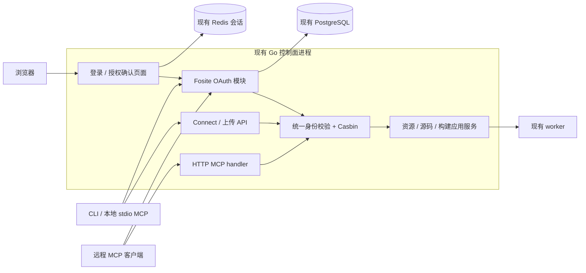

# Yummy OAuth 与 MCP 接入方案

状态：待评审设计。日期：2026-10-23。本文补充[产品方案](2026-10-22-agent-first-build-product-design.md)、[技术方案](2026-10-22-agent-first-build-technical-design.md)和[前端方案](2026-10-22-agent-first-build-frontend-design.md)，不表示认证后端已经实现。

2026-10-26 决定：第一版不实现本文的授权服务器与远程 HTTP MCP，CLI 与本地 stdio MCP 使用 PAT（见 [命名、集群与最小 CLI](2026-10-26-naming-cluster-and-minimal-cli-design.md)）；本文作为第一版之后的设计保留。

## 1. 进程约束与选型

产品只有控制面和 worker 两类常驻应用进程。授权服务器是控制面的逻辑角色，与网页、API、HTTP MCP 共用现有 Go 进程、数据库和部署包；不新增身份服务、OAuth 网关或后台任务服务。约束已写入项目 [AGENTS.md](../../../AGENTS.md)。

推荐 **Gin 会话组件 + Ory Fosite + Casbin**，分别处理网页登录状态、OAuth 协议、业务权限。[Fosite](https://github.com/ory/fosite)是可嵌入的 Go OAuth/OIDC 框架，提供协议 handler 与存储接口；本项目使用其授权码、刷新、撤销与 [PKCE handler](https://github.com/ory/fosite/tree/master/handler/pkce)，不启用 password grant、implicit grant 或与本版无关的流程。

Fosite 不附带生产数据库实现，也不替项目完成用户登录、授权页面、MCP 发现或客户端元数据校验。这些是控制面内需要完成的集成工作，M0 验证版本和接口后锁定依赖。不能把选用了框架等同于已符合整个 MCP 授权规范。

| 候选 | 判断 |
|---|---|
| Ory Fosite 库 | 首选；嵌入现有 Go 进程，复用现有用户与业务服务 |
| ZITADEL oidc Go 库 | 若后续需要完整 OIDC Provider，可比较；本版不再并用第二套协议核心 |
| Casdoor / Keycloak / Ory Hydra 独立服务 | 本版不采用，不符合当前简化进程与部署的约束 |
| `golang.org/x/oauth2` / `coreos/go-oidc` | 用作外部身份提供方的客户端；不能代替 OAuth 授权服务器 |

## 2. 三条登录与授权路径

| 使用方式 | 用户体验 | 控制面处理 |
|---|---|---|
| 网页登录 | 本地账号密码；可选已配置的团队 OIDC 登录 | 建立现有服务端 Cookie 会话 |
| CLI / 本地 stdio MCP | 第一版：`yummy login` 粘贴限定 PAT；之后：打开浏览器授权 | CLI 使用 API 令牌，本地 stdio MCP 复用 CLI 凭证 |
| 远程 HTTP MCP | 客户端发现授权配置，打开浏览器登录与确认权限 | 同一控制面签发面向该应用 MCP 的 OAuth 令牌 |

OAuth 用于委托访问，OIDC 用于确认外部登录身份。MCP 接入不要求 Yummy 自己成为完整 OIDC 身份平台。外部登录如启用，使用配置的 issuer、client ID 与回调地址，通过成熟客户端验证身份后映射本地用户；按 issuer + subject 唯一绑定，不仅凭邮箱自动合并账号，不自动授予工作空间成员资格。企业身份源管理、SCIM 和复杂 SSO 策略后置。

CLI 浏览器授权选择工作空间与允许访问的应用，API 令牌绑定该应用白名单；后续 `context use` 只改变本地默认值，不扩大授权范围。CLI 是 public client，不内置 client secret；使用授权码 + PKCE S256，按原生应用规范验证 loopback 回调、state 与 issuer。令牌优先存系统凭证库，退而使用仅本人可读的配置文件。PAT 是无人值守/兼容路径，明文仅显示一次，不能伪装成 OAuth 登录。

本地 stdio MCP 的凭证来自本地安全存储或环境，不执行 HTTP MCP 的授权握手；HTTP MCP 使用 OAuth。此区分依据 [MCP 授权规范](https://modelcontextprotocol.io/specification/2026-07-28/basic/authorization)。

## 3. 控制面内的模块与端点

| 端点 | 职责 |
|---|---|
| `/.well-known/oauth-authorization-server` | 授权服务器元数据，包含 issuer、端点、PKCE、客户端注册能力 |
| `/.well-known/oauth-protected-resource/mcp/apps/{application_id}` | 应用 MCP 的受保护资源元数据 |
| `/oauth/authorize`、`/oauth/token`、`/oauth/revoke` | 标准授权、换取/刷新、撤销；直接交给协议 handler，不包装 Connect JSON |
| `/oauth/consent` | 校验后的授权请求对应的确认页面及受 CSRF 保护的提交 |
| `/mcp/apps/{application_id}` | 控制面内的 Streamable HTTP MCP 入口 |
| Connect 身份管理服务 | 查询/撤销本人授权连接、管理实例允许的客户端；不返回令牌明文 |

授权请求先经协议库校验并保存在服务端，登录和同意页面只携带短时请求 ID，不信任页面传回的 client、resource、scope 或 redirect URI。拒绝时仅向已校验的回调发送标准错误；无效回调在本站显示错误。

公开 issuer 与资源地址来自显式 `PUBLIC_BASE_URL` 配置，不根据任意 Host/转发头拼接。OAuth 和 MCP 请求使用协议要求的错误格式；普通业务 API 继续使用 Connect 错误。

## 4. 资源、应用与权限

本版按应用提供 MCP URL，如 `https://build.example.com/mcp/apps/app_gateway`。连接页在当前工作空间中先选应用，再给出 URL；授权页面固定展示该应用。不同应用使用不同资源标识，减少一次授权意外覆盖其他应用的可能。

依据 [RFC 8707](https://www.rfc-editor.org/rfc/rfc8707.html)，授权与换取令牌请求中的 `resource` 绑定到规范资源 URI。API 令牌的 audience 为 `https://build.example.com/api`，MCP 令牌的 audience 为对应应用 MCP URL；不接受互换。刷新不能扩大资源、应用或 scope。Fosite 的 audience/session 与 `resource` 参数之间需要显式适配并做集成验证，不能假定库会自动完成。

建议固定 scope：`build:read`、`logs:read`、`build:write`，API 上传另需 `source:upload`。远程 MCP 默认只读，需要提交、取消或重建时再请求构建权限；授权页只列出客户端实际请求且用户有权授予的动作。`offline_access` 单独由用户同意，不混入 MCP 基础资源必需 scope。

每次调用的有效权限为：**当前用户状态与 Casbin 权限 ∩ OAuth 授权应用 ∩ 已授予 scope ∩ 客户端允许范围**。检查具体应用、快照、构建和日志的应用及工作空间归属。令牌不独立拥有角色，成员移除或降级后立即失去相应操作权。

MCP handler 验证令牌后构造内部 Principal，直接调用应用服务，不把 MCP Bearer 转发到公共 API，也不把外部身份提供方的 token 当作平台 API token。远程 MCP 无法读取电脑目录：本地 CLI/stdio 负责打包上传，远程工具提交已有的 `source_snapshot_id`。需要纯远程上传时另设计受限上传契约，不让大文件通过工具文本传输。

## 5. 发现、客户端与兼容性

应用 MCP 通过 [RFC 9728](https://www.rfc-editor.org/rfc/rfc9728.html)元数据及 `WWW-Authenticate` 告知客户端授权服务器。缺少/无效令牌返回 401；有效令牌 scope 不足返回 403 和所需范围。Bearer 只放请求头，不能放查询参数，每个 HTTP 请求都校验，不用 MCP session ID 代替认证。

客户端接入先提供预注册的第一方 CLI；第三方 MCP 优先支持 Client ID Metadata Documents（CIMD），受控预注册作为兼容方式。2026-07-28 版 [MCP 规范](https://modelcontextprotocol.io/specification/2026-07-28/basic/authorization)推荐 CIMD，DCR 已弃用并仅保留向后兼容，因此不把匿名动态注册作为首版必需条件。依赖 DCR 的旧客户端须明确标为暂不支持，不能宣称所有 MCP 客户端开箱即用。

CIMD 取回需要严格的 HTTPS、响应大小/超时、重定向、DNS/IP 与内网访问限制；客户端身份展示来自已校验元数据，但不因此显示“平台认证”标记。redirect URI 精确校验，原生应用仅按规范开放 loopback 端口例外。实现阶段用 MCP Inspector 和至少两个明确版本的目标客户端形成兼容清单。

## 6. 持久化与撤销

OAuth 状态存现有 PostgreSQL，使用 Fosite 存储接口的 GORM adapter；这里是本项目适配层，不假定存在开箱可用的官方 GORM adapter。Redis 继续只承担短期网页会话，不新增 OAuth 专属缓存进程。

| 对象 | 主要内容 |
|---|---|
| `oauth_clients` | client ID、注册来源、允许回调/资源/scope、启用状态；机密客户端秘密仅存散列 |
| `oauth_requests` | 短时登录/同意请求、已校验参数、PKCE、单次消费与过期 |
| `oauth_grants` | 用户、客户端、工作空间/应用、resource、scope、auth_version、授权/撤销时间 |
| `oauth_codes` / `oauth_access_tokens` / `oauth_refresh_tokens` | 按协议库存储接口拆分生命周期；持久化签名/摘要及 session 关联，不存完整 Bearer 明文；刷新族及重用标记 |

首版推荐有状态不透明 access token，同进程内通过库校验并检查数据库授权；无需独立 introspection 服务，也无需为此引入无状态 JWT 撤销黑名单。具体编码、签名和校验交给协议库。

建议 access token 15 分钟、授权码 5 分钟且单次使用、refresh token 最长 30 天；显式同意 `offline_access` 才签发刷新令牌。配置库的刷新 scope，避免照搬示例默认值。刷新轮换与旧值消费在事务中原子完成；重用导致整个刷新族失效，必须测试并发刷新和重启恢复。

“撤销连接”、客户端停用、用户停用与密码重设阻断后续 API/MCP 调用及刷新；账号撤销通过 auth_version 检查生效。撤销不自动取消已开始的构建。全局退出会话与撤销某个 Agent 是不同动作，页面明确影响范围。

### 6.1 首期 PaaS 权限补充

第一期同时覆盖发布和运行。OAuth scopes 增加 `deployment:read/write`、`runtime:read/write`、`config:read/write`；`logs:read` 包含获授权应用的运行日志，runtime:read 包含资源监控。构建、发布、运行变更与配置修改分别授权，默认不授予写权限；config:read 只能读取结构、普通配置与敏感键的版本/已配置状态，不能取得敏感明文。固定角色矩阵、CLI/MCP 操作与 expected revision 约束见 [首期运行方案](2026-10-23-paas-v1-runtime-design.md)。

## 7. 页面与实施验收

个人账户独立于工作空间，使用 /account/connections 与 /account/tokens；账户菜单提供“Agent 接入”页面，普通成员同样可用；页面不继承当前空间的导航与所有权。连接/PAT 的 owner 为 user_id，resource/scope 可以限定有权访问的空间与应用；空间管理员不能管理他人的个人凭证。空间菜单的管理入口只面向管理员。Agent 页面提供本地目录方式、远程 MCP 应用地址、浏览器授权说明和已授权连接；PAT 保持在“访问令牌”页。OAuth 确认页显示客户端名称/来源、当前账号、工作空间/应用、具体权限、离线访问与拒绝/允许按钮。完成页提示返回客户端，不显示或复制 token。

第一版之后分阶段实施：先在现有控制面路由中验证 Fosite + PostgreSQL、授权码/PKCE、资源绑定、发现与目标客户端；再交付 CLI 浏览器授权；最后交付远程 HTTP MCP、CIMD 和授权管理。每个阶段都执行相同业务权限，不能先发布无认证的 MCP。

正式实现须验证：缺失/错误 PKCE、授权码重放、回调/issuer 篡改、跨应用/audience 拒绝、scope 扩大拒绝、刷新竞争与重用、即时撤销、第三方登录身份绑定、CIMD SSRF 防护，以及本地打包→上传→远程查询的真实流程。本轮仅验证静态原型，未安装 Fosite、未实现 OAuth handler、未验证真实客户端兼容性。
